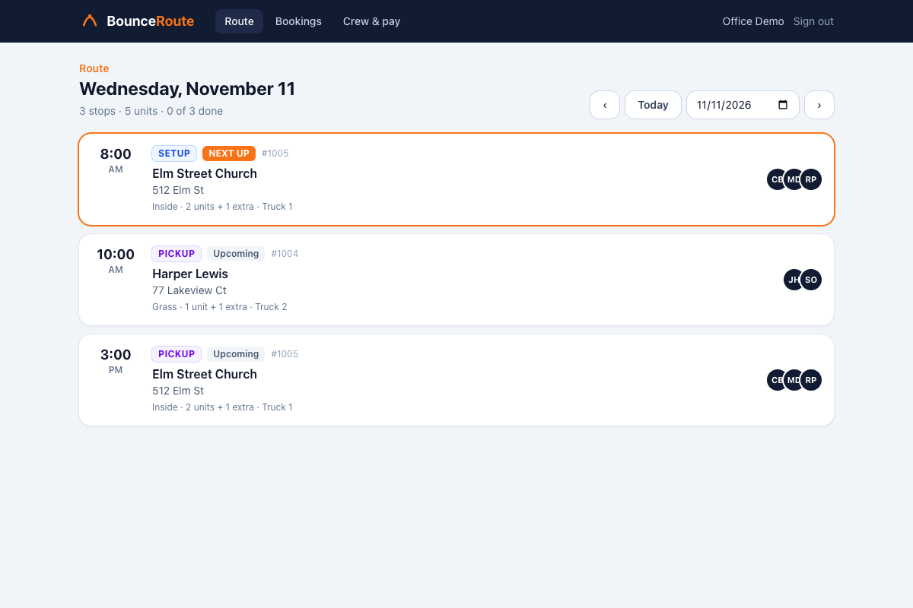
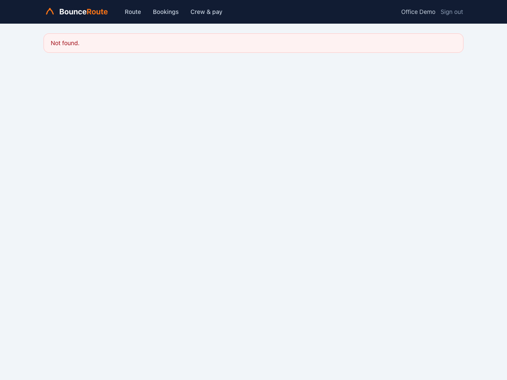
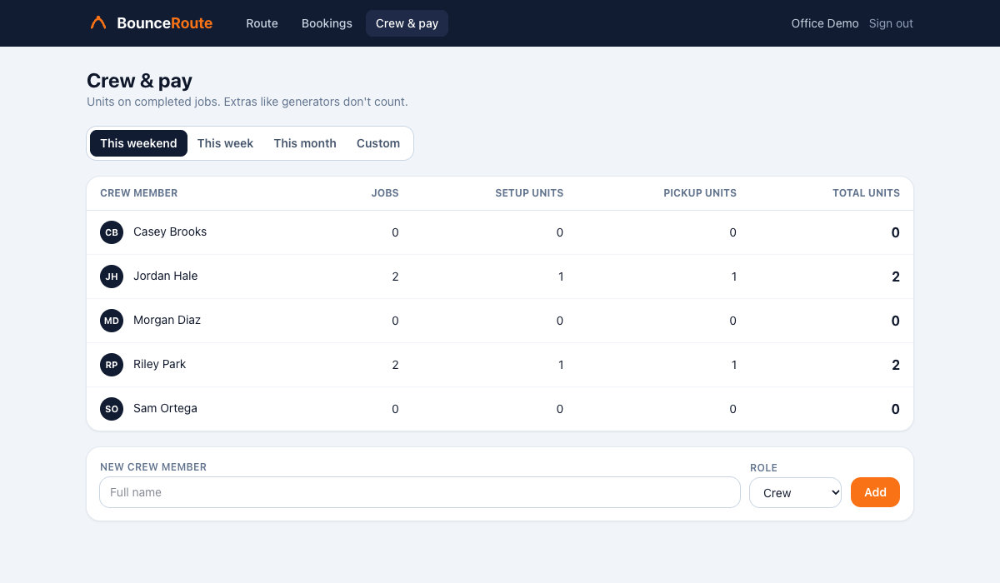
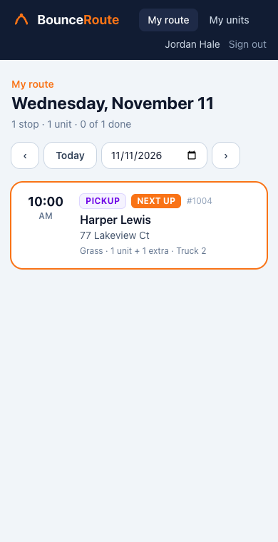
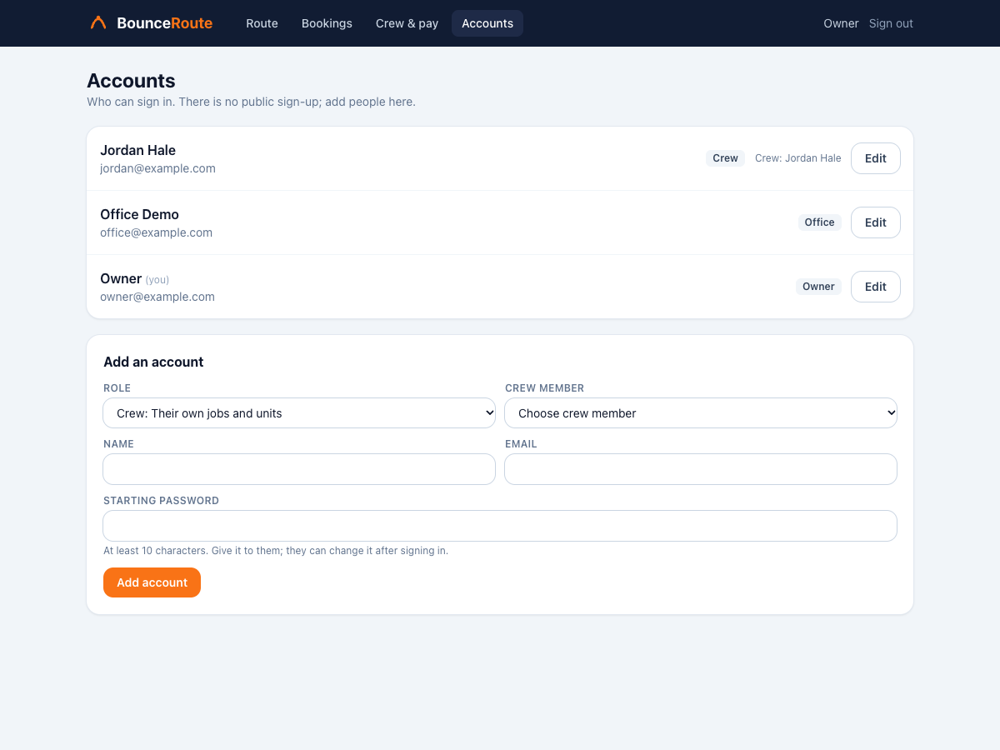

# BounceRoute

Scheduling and route management for a party rental company that delivers bounce houses, water slides, and other inflatables.

The office books rentals, builds each day's route, and assigns trucks and crews. Crews sign in on their phones to see their own stops in order, check items off as they load them, and mark jobs complete. Crew pay is based on how many units (bounce houses, slides) each person set up or picked up, so the app counts those automatically.



| Job details | Crew pay |
| --- | --- |
|  |  |

| Crew view on a phone | Owner's account management |
| --- | --- |
|  |  |

## Stack

| Layer | Tech |
| --- | --- |
| Frontend | React 19, TypeScript, Vite, Tailwind CSS v4, TanStack Query, React Router |
| API | ASP.NET Core 10 minimal APIs, EF Core 10, ASP.NET Core Identity |
| Database | PostgreSQL 16 |
| Contract | OpenAPI document generated at build time → TypeScript types via `openapi-typescript` → typed client with `openapi-fetch` |
| Tests | xUnit + `WebApplicationFactory` + Testcontainers (real Postgres) · Vitest + Testing Library |
| CI | GitHub Actions: build, test, and fail if the OpenAPI document or generated types are stale |

```
React (web/) ──/api──▶ ASP.NET Core API (api/BounceRoute.Api) ──EF Core──▶ PostgreSQL
      ▲                          │
      └── src/api/schema.d.ts ◀──┴── openapi/BounceRoute.Api.json (written on every API build)
```

Changing a request or response type in C# changes the OpenAPI file, which changes the generated TypeScript types, so the frontend stops compiling until it's updated. CI checks that both generated files are committed.

## How the data fits together

- A **booking** is one customer rental: address, ground surface, site notes, and the **items** going out.
- Every booking has exactly two **jobs**: a setup and a pickup. Each job has its own time, truck, and crew (via **job assignments**).
- An item is either a **unit** (counts toward pay) or an **extra** like a generator (doesn't).
- Pay totals = units on *completed* jobs a crew member was assigned to. The "weekend" runs Friday through Monday, since Monday pickups belong to the weekend.
- Job times are stored in UTC. A day's route is computed in the business time zone (`Business:TimeZone`, default `America/New_York`), so an 11 PM job stays on the right day and days with DST changes are handled. Tests cover both.

## Sign-in and roles

| Role | Can do |
| --- | --- |
| **Owner** | Everything, plus add accounts, change roles, reset passwords, and turn accounts off |
| **Office** | Bookings, routes, crew, and everyone's pay totals |
| **Crew** | Only the jobs they're assigned to: see them, check off loading, mark complete (as themselves), and see their own units |

How it works:

- **No public sign-up.** The first owner comes from config (`Auth:BootstrapOwner`) on a fresh install; after that the owner creates every account.
- **Cookie sessions.** ASP.NET Core Identity issues an `HttpOnly`, `SameSite=Strict` cookie, so there's no token for JavaScript to leak. The web app and API are served from the same site.
- **Rules live in the API.** Endpoint groups require a role policy, and crew queries are filtered to their assigned jobs (someone else's job returns 404, not 403, so ids don't leak). The React app hides screens a role can't use, but that's only for convenience.
- **The crew link is in the cookie.** A crew account's crew member id is a claim, so filtering by crew member needs no extra lookup. Role changes, disables, and password resets update the security stamp, and open sessions pick that up within a minute.
- **Guessing is slowed down.** Accounts lock for a few minutes after 5 wrong passwords, and login is rate-limited to 10 tries a minute per IP address. Passwords need at least 10 characters with no composition rules (NIST 800-63B).

## Run it locally

Prerequisites: .NET 10 SDK, Node 24, and Postgres (either your own or Docker).

```bash
# 1. Database: either use Docker…
docker compose up -d
# …or your own Postgres:
#   CREATE ROLE bounceroute LOGIN PASSWORD 'bounceroute' CREATEDB;
#   CREATE DATABASE bounceroute OWNER bounceroute;

# 2. API on http://localhost:5125 (applies migrations and seeds made-up sample data in Development)
dotnet run --project api/BounceRoute.Api

# 3. Web on http://localhost:5173 (proxies /api to the API)
cd web
npm install
npm run dev
```

OpenAPI JSON is served at http://localhost:5125/openapi/v1.json.

Demo sign-ins (Development only):

| Email | Password | Role |
| --- | --- | --- |
| owner@example.com | bounceroute-owner | Owner |
| office@example.com | bounceroute-office | Office |
| jordan@example.com | bounceroute-crew | Crew (Jordan Hale) |

## Tests

```bash
dotnet test        # API integration tests; needs Docker running (Testcontainers starts Postgres)
cd web && npm test # unit and component tests (fetch is stubbed; no API needed)
```

## Common tasks

```bash
# After changing the EF model
dotnet ef migrations add <Name> --project api/BounceRoute.Api --output-dir Data/Migrations

# After changing API contracts: build the API, then regenerate the frontend types
dotnet build api/BounceRoute.Api
cd web && npm run gen:api
```

## Project layout

```
api/BounceRoute.Api/
  Domain/        entities (Booking, Job, BookingItem, CrewMember, JobAssignment)
  Contracts/     request/response records; these become the OpenAPI schema
  Endpoints/     minimal API route groups: route & jobs, bookings, crew & pay
  Data/          DbContext, migrations, business clock, dev seed data
api/BounceRoute.Api.Tests/   integration tests against real Postgres, incl. who-can-see-what
web/src/
  api/           generated schema, typed client, React Query hooks
  auth/          current user, sign-in/out, route guards
  pages/         Route, Job, Bookings, Booking form, Crew & pay, My units, Accounts, Sign in
  components/    layout, job card, badges
openapi/         generated OpenAPI document (committed)
```

## Roadmap

- [x] Sign-in with roles: owner, office, crew (crew see only their jobs)
- [ ] Deploy (API + Postgres + static site) with a public demo
- [ ] Connect the .NET MAUI crew app to this API, keeping SQLite as an offline cache
- [ ] Text crews when their schedule changes
- [ ] Customer availability calendar so units can't be double-booked

All names, addresses, and phone numbers in the seed data and screenshots are made up.
