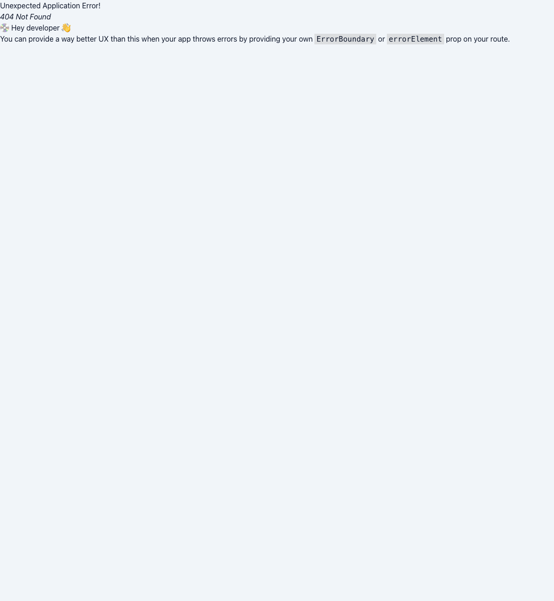
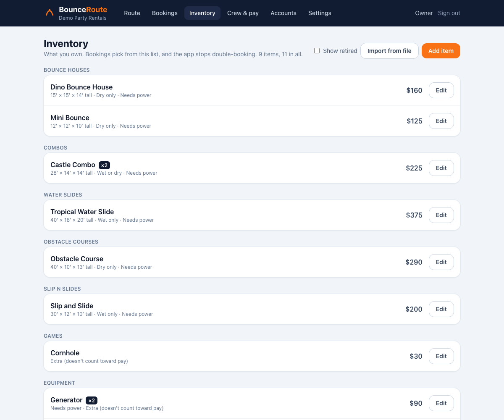

# BounceRoute

Scheduling and route management for a party rental company that delivers bounce houses, water slides, and other inflatables.

The office books rentals from the company's inventory, builds each day's route, and assigns trucks and crews. The app won't let a unit be double-booked. Crews sign in on their phones to see their own stops in order, check items off as they load them, and mark jobs complete. Crew pay is based on how many units (bounce houses, slides) each person set up or picked up, so the app counts those automatically.


| Job details | Crew pay |
| --- | --- |
|  |  |

| Crew view on a phone | Owner's account management |
| --- | --- |
|  |  |

| Booking with inventory, wet/dry, and availability | Inventory |
| --- | --- |
|  |  |

## Stack

| Layer | Tech |
| --- | --- |
| Frontend | React 19, TypeScript, Vite, Tailwind CSS v4, TanStack Query, React Router |
| API | ASP.NET Core 10 minimal APIs, EF Core 10, ASP.NET Core Identity |
| Database | PostgreSQL 16 |
| Contract | OpenAPI document generated at build time → TypeScript types via `openapi-typescript` → typed client with `openapi-fetch` |
| Tests | xUnit + `WebApplicationFactory` + Testcontainers (real Postgres) · Vitest + Testing Library |
| CI | GitHub Actions: build, test, and fail if the OpenAPI document or generated types are stale |

```
React (web/) ──/api──▶ ASP.NET Core API (api/BounceRoute.Api) ──EF Core──▶ PostgreSQL
      ▲                          │
      └── src/api/schema.d.ts ◀──┴── openapi/BounceRoute.Api.json (written on every API build)
```

Changing a request or response type in C# changes the OpenAPI file, which changes the generated TypeScript types, so the frontend stops compiling until it's updated. CI checks that both generated files are committed.

## How the data fits together

- **Inventory** is what the company owns: category, how many copies, size, wet/dry use, power, and price.
- Each inventory item can have a **photo**, shown to the office when booking and to crews on their loading list. The browser shrinks photos to 1600px JPEG before upload (a 4 MB phone photo becomes ~200 KB). The server checks the file's bytes to accept only real JPEG/PNG/WebP, and stores photos in Postgres rather than on disk, since free hosts wipe disks on restart. Photo URLs carry a version, so browsers cache them until the photo changes.
- A **booking** is one customer rental: address, ground surface, site notes, and the **items** going out. Items are picked from inventory (with wet or dry chosen when a unit can go either way) or typed in as one-offs.
- Every booking has exactly two **jobs**: a setup and a pickup. Each job has its own time, truck, and crew (via **job assignments**).
- An item is either a **unit** (counts toward pay) or an **extra** like a generator (doesn't). Booked items copy their name and pay rule from inventory, so editing the catalog later doesn't rewrite old bookings.
- **Route plans.** The owner sets setup minutes per unit type (any unit can override). For each truck, the app adds up time on site and real drive times between stops (OpenRouteService, one matrix request per truck, cached for a day) to show when to leave the shop, which stops will run late, and when the truck will be done. Addresses are geocoded once and re-checked only when edited. Without a map key the plan still works, with setup time only.
- **Route optimizer.** Bookings record when the party starts and ends. The office picks which trucks go out each day, and each truck has a capacity in pieces (each item says how many pieces it takes; a 30 ft slide is 2). When a day is opened, the API sends its stops to OpenRouteService's optimizer (VROOM) as a vehicle-routing problem with time windows: setup finished 10 minutes before the party, pickup within 2 hours after it ends, trucks starting and ending at the shop. The answer is re-planned with the same timing code as the current plan, and offered only if it's better (fewer late stops, or everyone back 15+ minutes sooner). One "Use this plan" call applies it, guarded by a fingerprint of every input so a stale suggestion can't overwrite newer changes. It can be switched off in Settings for fully manual planning.
- **Map failures aren't "not found".** Address lookups report found, not found, or failed (service down, quota used up). Only real not-founds wait for the address to be edited; failures are retried the next time a plan needs them.
- **No double-booking.** A booking holds its items from setup until pickup. Saving is refused if overlapping bookings already use every copy the company owns. Saves run under a Postgres advisory lock so two people can't take the last unit at the same moment, and a test proves that race is caught.
- Pay totals = units on *completed* jobs a crew member was assigned to. The "weekend" runs Friday through Monday, since Monday pickups belong to the weekend.
- Job times are stored in UTC. A day's route is computed in the business time zone (`Business:TimeZone`, default `America/New_York`), so an 11 PM job stays on the right day and days with DST changes are handled. Tests cover both.

## Sign-in and roles

| Role | Can do |
| --- | --- |
| **Owner** | Everything, plus add accounts, change roles, reset passwords, and turn accounts off |
| **Office** | Bookings, routes, crew, and everyone's pay totals |
| **Crew** | Only the jobs they're assigned to: see them, check off loading, mark complete (as themselves), and see their own units |

How it works:

- **No public sign-up.** The first owner comes from config (`Auth:BootstrapOwner`) on a fresh install; after that the owner creates every account.
- **Cookie sessions.** ASP.NET Core Identity issues an `HttpOnly`, `SameSite=Strict` cookie, so there's no token for JavaScript to leak. The web app and API are served from the same site.
- **Rules live in the API.** Endpoint groups require a role policy, and crew queries are filtered to their assigned jobs (someone else's job returns 404, not 403, so ids don't leak). The React app hides screens a role can't use, but that's only for convenience.
- **The crew link is in the cookie.** A crew account's crew member id is a claim, so filtering by crew member needs no extra lookup. Role changes, disables, and password resets update the security stamp, and open sessions pick that up within a minute.
- **Guessing is slowed down.** Accounts lock for a few minutes after 5 wrong passwords, and login is rate-limited to 10 tries a minute per IP address. Passwords need at least 10 characters with no composition rules (NIST 800-63B).

## Company data stays private

The repo is generic; nothing about a specific company is in the code. The company name and default town are **Settings** the owner fills in, and the real inventory is loaded into the database:

- **One at a time** on the Inventory page, or
- **All at once** with *Import from file* (a JSON list, matched by name so re-importing updates instead of duplicating).

Keep company files in `private/`, which git ignores. Development databases start with made-up sample inventory and bookings instead.

## Run it locally

Prerequisites: .NET 10 SDK, Node 24, and Postgres (either your own or Docker).

```bash
# 1. Database: either use Docker…
docker compose up -d
# …or your own Postgres:
#   CREATE ROLE bounceroute LOGIN PASSWORD 'bounceroute' CREATEDB;
#   CREATE DATABASE bounceroute OWNER bounceroute;

# 2. API on http://localhost:5125 (applies migrations and seeds made-up sample data in Development)
dotnet run --project api/BounceRoute.Api

# 3. Web on http://localhost:5173 (proxies /api to the API)
cd web
npm install
npm run dev
```

OpenAPI JSON is served at http://localhost:5125/openapi/v1.json.

Drive times are optional. To turn them on, get a free key at [openrouteservice.org](https://openrouteservice.org/dev/#/signup) and store it outside the repo:

```bash
dotnet user-secrets set "Maps:OpenRouteServiceKey" "<your key>" --project api/BounceRoute.Api
```

Demo sign-ins (Development only). All three use the same password, with no symbols so it types the same on any keyboard:

| Email | Password | Role |
| --- | --- | --- |
| owner@example.com | bounceroute2026 | Owner |
| office@example.com | bounceroute2026 | Office |
| jordan@example.com | bounceroute2026 | Crew (Jordan Hale) |

## Tests

```bash
dotnet test        # API integration tests; needs Docker running (Testcontainers starts Postgres)
cd web && npm test # unit and component tests (fetch is stubbed; no API needed)
```

## Common tasks

```bash
# After changing the EF model
dotnet ef migrations add <Name> --project api/BounceRoute.Api --output-dir Data/Migrations

# After changing API contracts: build the API, then regenerate the frontend types
dotnet build api/BounceRoute.Api
cd web && npm run gen:api
```

## Project layout

```
api/BounceRoute.Api/
  Domain/        entities (Booking, Job, BookingItem, CrewMember, JobAssignment)
  Contracts/     request/response records; these become the OpenAPI schema
  Endpoints/     minimal API route groups: route & jobs, bookings, crew & pay
  Data/          DbContext, migrations, business clock, dev seed data
api/BounceRoute.Api.Tests/   integration tests against real Postgres, incl. who-can-see-what
web/src/
  api/           generated schema, typed client, React Query hooks
  auth/          current user, sign-in/out, route guards
  pages/         Route, Job, Bookings, Booking form, Inventory, Crew & pay, My units, Accounts, Settings, Sign in
  components/    layout, job card, badges
openapi/         generated OpenAPI document (committed)
```

## Roadmap

- [x] Sign-in with roles: owner, office, crew (crew see only their jobs)
- [ ] Deploy (API + Postgres + static site) with a public demo
- [ ] Connect the .NET MAUI crew app to this API, keeping SQLite as an offline cache
- [ ] Text crews when their schedule changes
- [x] Inventory with quantities, wet/dry, and double-booking prevention
- [x] Route plans with setup and drive times
- [x] Suggested routes: which truck takes which stop, and when
- [ ] Calendar view of what's booked when

All names, addresses, and phone numbers in the seed data and screenshots are made up.
